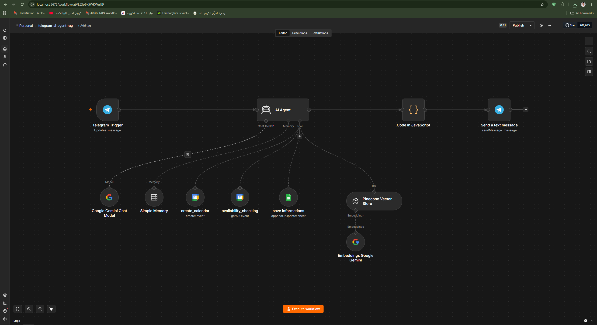

# 🤖 AutomateAI Morocco – Enterprise AI Receptionist & Lead Qualification System

A robust, end-to-end automated AI agent built in **n8n** that functions as an intelligent virtual receptionist and lead qualification specialist for digital agencies and local businesses. It handles multi-lingual customer inquiries, retrieves company knowledge using RAG, qualifies leads, performs smart calendar conflict detection, and updates CRM records in real-time.

---

## 📸 Workflow Architecture

---

## ✨ Key Features
- **Multi-Lingual Natural Communication:** Dynamically detects the language of the user's latest message (English, Moroccan Darija, or French) and responds fluently in the exact same language.
- **Retrieval-Augmented Generation (RAG):** Connected to a Pinecone Vector Store via Google Gemini Embeddings to fetch precise, contextual information about agency services, pricing, and operational processes.
- **Smart Calendar Conflict Detection:** Automatically checks existing schedules using Google Calendar APIs before booking meetings to prevent overlapping time slots.
- **Lead Qualification & CRM Sync:** Scores leads (Hot/Warm/Cold), extracts essential contact details, and logs/updates lead summaries instantaneously into Google Sheets.
- **Robust Error Handling & JSON Parsing:** Utilizes custom JavaScript code nodes with safe regex extraction to handle LLM outputs and maintain stable execution streams without infinite loops.

---

## 🛠️ Tech Stack & Architecture
- **Orchestration:** n8n (Self-Hosted Workflow Automation Engine)
- **AI & LLM:** Google Gemini Chat Model & Google Gemini Embeddings
- **Vector Database:** Pinecone
- **Messaging Channel:** Telegram Bot API
- **Operations & Scheduling:** Google Calendar API (configured for `Africa/Casablanca` timezone)
- **Data Storage:** Google Sheets API
- **Data Formatting:** JavaScript (Regex Parsing & Exception Handling)

---

## 🔄 Workflow Architecture Overview
1. **Trigger Node:** Listens for incoming client messages via the Telegram Bot API.
2. **AI Agent Node:** Powered by Google Gemini, maintaining conversational context via Simple Memory, accessing company data via Pinecone RAG, and calling scheduling tools.
3. **Calendar Tools:**
   - `availability_checking`: Queries Google Calendar to inspect free/busy slots.
   - `create_calendar`: Books consultations once date, time, name, and email are confirmed.
4. **Data Logging Node:** Appends or updates lead details, scores, and conversation summaries in Google Sheets (`save informations`).
5. **Code Node:** Safely extracts structured JSON payloads from the AI model using regex-based exception handling to format clean responses.
6. **Action Node:** Sends the final, polished response back to the client via Telegram.

---

## 📥 How to Import & Setup

1. **Download Workflow:** Download the JSON file [`telegram-ai-agent-rag-n8n.json`](./telegram-ai-agent-rag-n8n.json) from this repository.
2. **Import into n8n:** Open your n8n instance, go to **Workflows** -> **Import from File**, and upload the `.json` file.
3. **Configure Credentials:**
   - **Telegram:** Add your Telegram Bot Token.
   - **Google Gemini:** Add your Google Gemini API key.
   - **Pinecone:** Connect your Pinecone API Key & Index name.
   - **Google Workspace:** Connect Google Calendar & Google Sheets OAuth2 integrations.
4. **Activate:** Enable the workflow trigger and start managing inquiries automatically!
